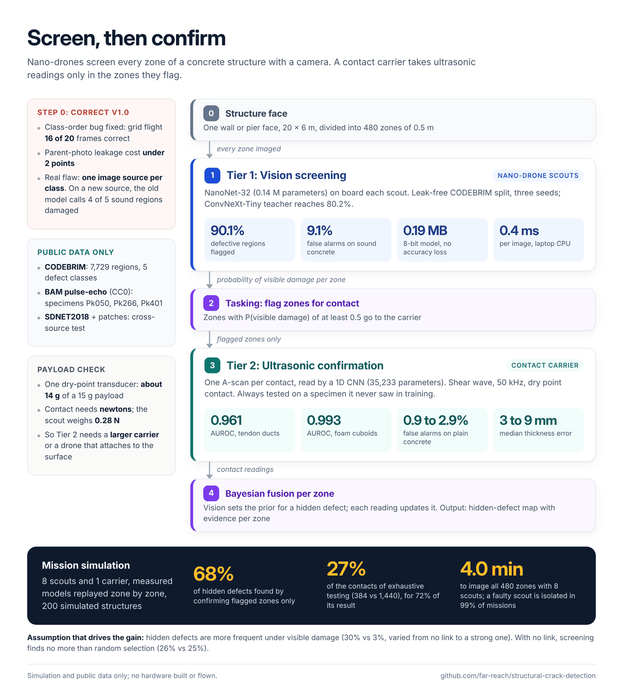
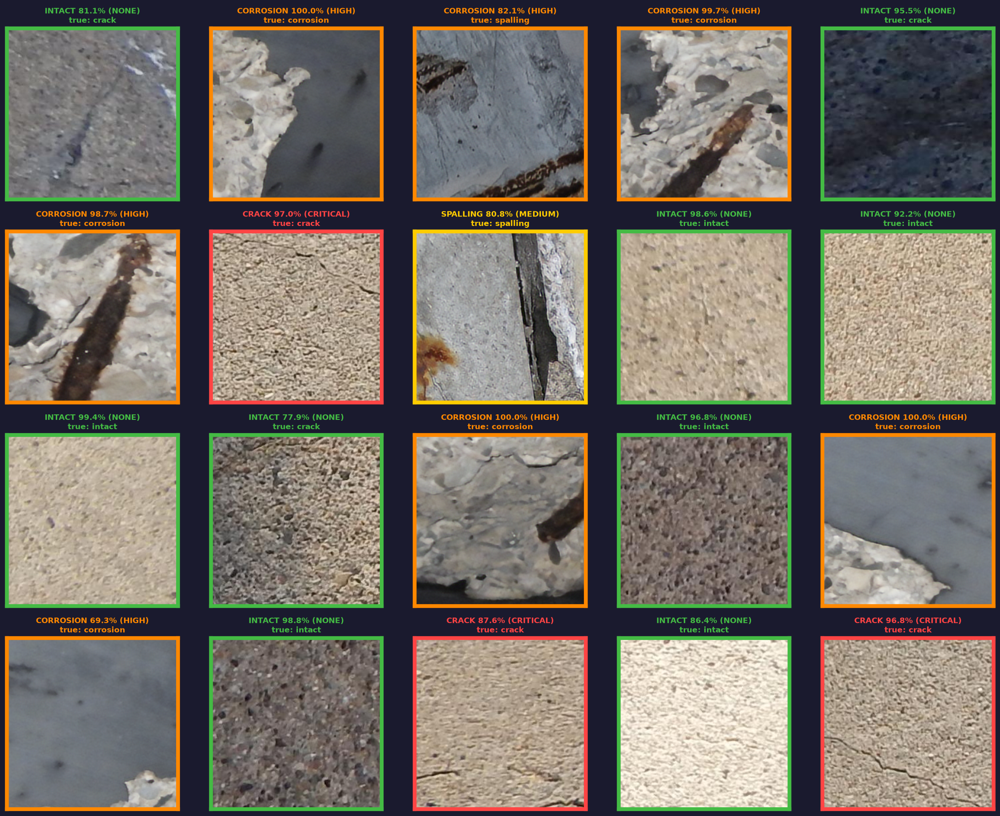
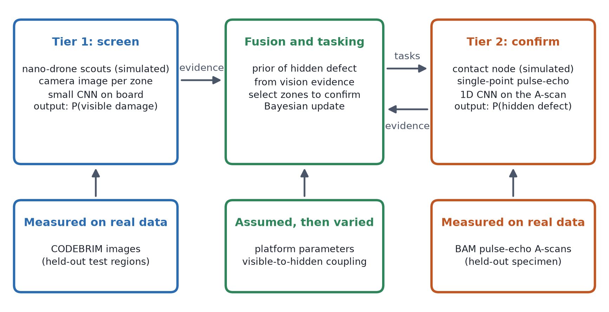
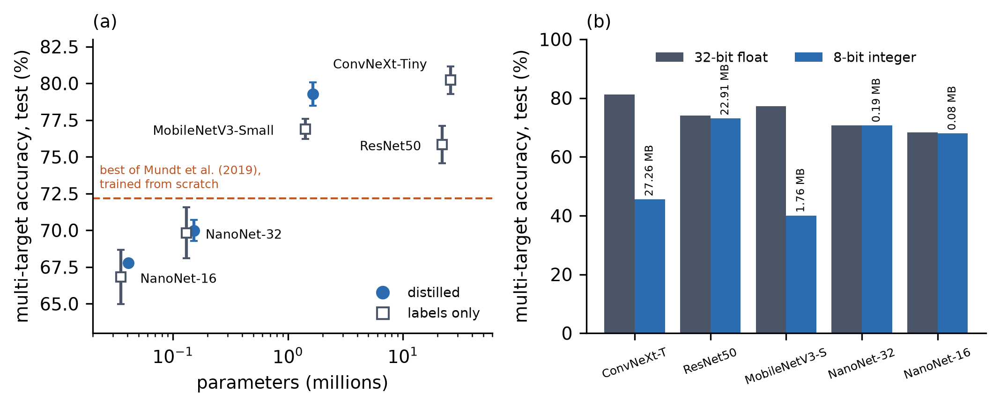
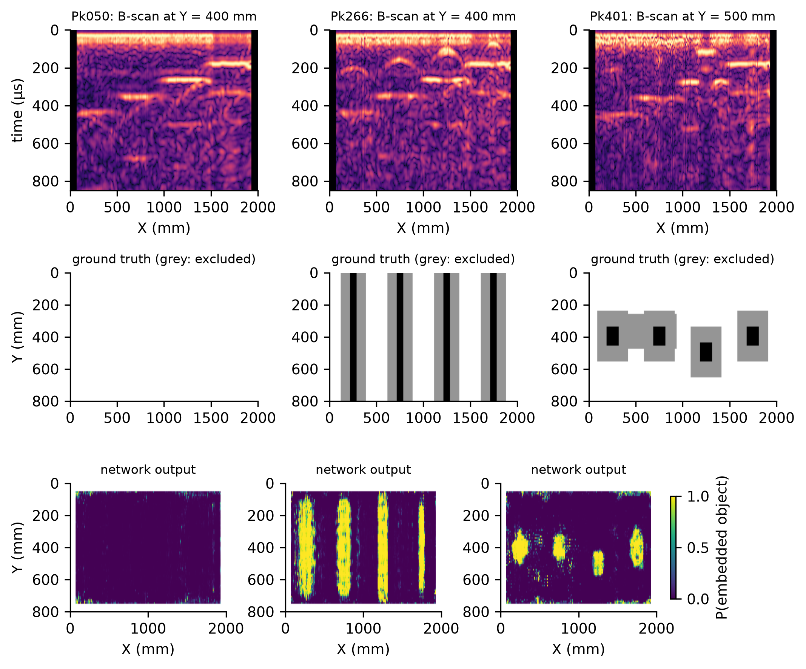
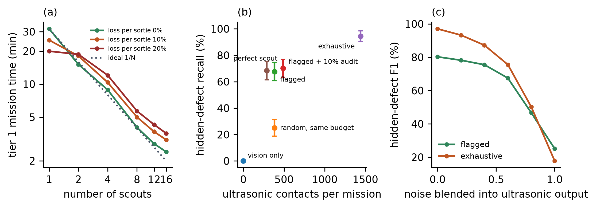

# Structural crack detection: screen, then confirm

Code and results for two studies by Seyed Farhad Abtahi.



- **Version 2.0 (this version):** "Screen, then confirm: nano-drone vision screening with single-point ultrasonic confirmation for concrete inspection." Manuscript complete; the preprint link will be added here when it is posted.
- **Version 1.0:** "Automated Multi-Class Structural Damage Detection and Segmentation for UAV-Based Infrastructure Inspection Using Deep Learning", engrXiv preprint, [doi.org/10.31224/7685](https://doi.org/10.31224/7685). The v1.0 scripts and figures remain in the repository root and in `results/`.

No hardware was built or flown. The swarm results are simulations, and every assumed parameter is marked as assumed.

## Correction notice for version 1.0

An audit of the v1.0 code for the second study found the following. The preprint itself is unchanged; the corrected values are reported in the v2.0 paper and below.

1. **Class-order error.** The Stage 1 classifier was trained with the alphabetical class order (corrosion, crack, intact, spalling). `drone_simulation.py`, `gradcam.py`, `fix_gradcam.py` and `failure_analysis.py` decoded its outputs with the order crack, intact, corrosion, spalling. Corrosion was therefore printed as crack, crack as intact and intact as corrosion.
2. **Affected results.** The Stage 3 result "16 of 20 zones detected (80%)", the Grad-CAM figure and the failure-analysis figure. With the released weights and the correct order, 16 of 20 frames are classified correctly and 11 of the 14 damaged zones are flagged, with no false alarm on the 6 intact zones. The three published "failure cases" were correct predictions. Corrected figures are in `results_v2/audit/`.
3. **Not affected.** Stage 1 accuracy (85.69%), its confusion matrix and per-class F1, the ablation, the Stage 2 segmentation results and the timing figures. The original split was rebuilt and the confusion matrix reproduced cell for cell.
4. **Evaluation protocol.** The v1.0 validation split shares parent photographs with the training split (all 1,200 SDNET2018 validation tiles), contains 236 augmented images, and pairs each class with one image source. Retraining the v1.0 recipe three times under a grouped split with original images only gives 83.2 ± 1.4% accuracy against 83.6 ± 0.7% under the original split, so the parent leak itself changed little. The source pairing is the serious flaw: applied to CODEBRIM, the released classifier calls only 19.5% of sound concrete regions intact. On original validation images the F1 of spalling is 0.71 to 0.73, not 0.886.
5. **Repository hygiene.** The previous `.gitignore` was stored as UTF-16 and was not read by git. It is now UTF-8.

<p align="center"><br>
<sub>The v1.0 grid flight, re-run with the released weights and the correct class order: predicted class and confidence against the true class for each frame.</sub></p>

All four scripts now import the class list from `inspectswarm/classes.py`, and `tests/test_classes.py` fails if any script defines its own.

## What version 2.0 contains

| Part | Data | Main result |
|---|---|---|
| Audit of v1.0 | released v1.0 weights, rebuilt split | see the correction notice |
| Vision tier | CODEBRIM, official image-level split | ConvNeXt-Tiny teacher 80.2 ± 0.9% multi-target accuracy (3 seeds); NanoNet-32 (0.14 M parameters, 0.19 MB as 8-bit) 69.8 ± 1.7% |
| Ultrasonic tier | BAM pulse-echo data of specimens Pk050, Pk266, Pk401 | embedded objects detected from one shear-wave A-scan of an unseen specimen with AUROC 0.96 (tendon ducts) and 0.99 (foam cuboids); median thickness error 3 to 9 mm |
| Swarm tier | simulation that replays the two trained classifiers | 8 simulated scouts image 480 zones in 4.0 min; contact testing of flagged zones finds 72% of what exhaustive testing finds at 27% of its cost, under an assumed link between visible and hidden damage |

Negative and limiting results are reported with the same weight: distillation did not improve the two smallest networks; default 8-bit quantisation breaks ConvNeXt-Tiny and MobileNetV3-Small; models trained on one image source lose much of their accuracy on another; a nano-drone cannot carry or press an ultrasonic probe in free flight.

Tables: `results_v2/tables.md`. Figures: `results_v2/figures/`. Every JSON file in `results_v2/` holds the result together with a manifest (configuration, seed, package versions, git commit, hardware, time).

## Figures

<table>
<tr>
<td width="50%"><br><sub><b>Framework.</b> What is measured on real data and what is assumed, then varied.</sub></td>
<td width="50%"><br><sub><b>Vision tier.</b> Accuracy against model size, with and without distillation, and the effect of 8-bit quantisation.</sub></td>
</tr>
<tr>
<td><br><sub><b>Ultrasonic tier.</b> B-scans, ground truth and detector output for each specimen, always from a network trained without that specimen.</sub></td>
<td><br><sub><b>Swarm tier.</b> Mission time against swarm size, hidden-defect recall against contact budget, and robustness to a degraded ultrasonic sensor.</sub></td>
</tr>
</table>

## Layout

```
inspectswarm/          library code
  classes.py           the only definition of class lists and class order
  paths.py             data locations (outside the repository)
  manifest.py          seeding and result files with run manifests
  vision.py            models, GPU augmentation, training, metrics
  ultrasonic.py        A-scan loading, labels, filtering, thickness, 1D network
  swarm.py             mission simulator, fusion rule, policies
experiments/           one script per experiment (see "Reproducing")
audit/                 scripts of the v1.0 audit
tests/                 class order, split integrity, signal processing, simulator
results_v2/            result files, tables and figures of version 2.0
results/               figures of version 1.0 (unchanged; three are superseded, see above)
*.py (root)            version 1.0 scripts
```

## Installation

```bash
python -m venv .venv
.venv/Scripts/activate        # Linux and macOS: source .venv/bin/activate
pip install -r requirements.txt
pytest
```

The code runs on CPU by default and uses a GPU when one is present. `requirements.txt` lists the exact versions used for the reported results (Python 3.14).

## Data

No dataset is stored in this repository. Set the environment variable `INSPECTSWARM_ROOT` to a folder outside the repository (default: the parent folder of the repository) and place the data as follows.

| Dataset | Used for | Source | Expected location under `INSPECTSWARM_ROOT` |
|---|---|---|---|
| CODEBRIM, classification version | vision tier | https://doi.org/10.5281/zenodo.2620293 | `datasets/codebrim/extracted/classification_dataset/` |
| SDNET2018 | audit, leak study, cross-source test | https://digitalcommons.usu.edu/all_datasets/48/ | `datasets/sdnet2018/` |
| Corrosion and spalling patches (Raidathmane) | audit, leak study, cross-source test | https://www.kaggle.com/datasets/raidathmane/corrosion-and-spalling-concrete-defect-segmentation | `datasets/raidathmane/spalling_corrosion_patches/` |
| BAM pulse-echo data, Pk050, Pk266, Pk401 | ultrasonic tier | Harvard Dataverse, see the data articles cited in the paper | `datasets/bam_ultrasonic/{pk050,pk266,pk401}/` |

The CODEBRIM archive has more than 65,535 entries and some unzip tools fail on it; Python's `zipfile` module reads it.

## Weights

Weights are distributed as release assets, never through git.

- v1.0: https://github.com/far-reach/structural-crack-detection/releases/tag/v1.0
- v2.0: attached to the v2.0 release.

Place them in `models/` (ignored by git).

## Reproducing version 2.0

```bash
# audit of v1.0 (needs the v1.0 weights in models/)
python audit/rebuild_stage1_split.py
python audit/verify_class_order.py
python audit/reeval_stage1_stage3.py
python audit/regen_figures_correct_order.py
python experiments/leak_study.py --seeds 0 1 2

# vision tier
python experiments/cache_codebrim.py
bash experiments/run_vision_queue.sh          # all models, three seeds; several GPU hours
python experiments/edge_benchmark.py --tags convnext_tiny_r224_s0 resnet50_r224_s0 mobilenetv3_small_100_r224_s0 nano32_r128_s0 nano16_r96_s0
python experiments/cross_source.py   --tags convnext_tiny_r224_s0 resnet50_r224_s0 mobilenetv3_small_100_r224_s0 nano32_r128_s0 nano16_r96_s0

# ultrasonic tier
python experiments/ultrasonic_thickness.py
python experiments/train_ultrasonic.py --wave Shear --rot 90 --seeds 0 1 2    # also: Shear 00, Long 00, Long 90

# swarm tier
python experiments/run_swarm.py --vision nano32_r128_s0 --ut Shear_Rot90 --trials 200

# tables and figures
python experiments/make_tables.py > results_v2/tables.md
python experiments/make_figures.py --ut Shear_Rot90 --swarm swarm_nano32_r128_s0__Shear_Rot90.json
```

Seeds are fixed, but GPU training is not bit-reproducible across hardware; expect differences of the size of the reported standard deviations.

## Limits

- The swarm tier is a mission-level simulation without flight dynamics, wind, localisation error or communication.
- The scout stands for a class (camera-carrying nano-quadrotor with on-board inference). All scout parameters come from the Crazyflie 2.1 datasheet and are marked as assumed. The swarm is the author's own construction; no swarm version of any existing platform is implied.
- The link between visible damage and hidden defects is an assumption, which the paper varies.
- The ultrasonic data are laboratory measurements by an automated scanner, not by an aircraft.

## Citation

See `CITATION.cff`. Until the v2.0 paper is published, cite the preprint for v1.0 and this repository for the corrections:

```
Abtahi, S.F. (2026). Automated Multi-Class Structural Damage Detection and
Segmentation for UAV-Based Infrastructure Inspection Using Deep Learning.
engrXiv. https://doi.org/10.31224/7685
```

## Licence

Code: MIT, see [LICENSE](LICENSE). Result files and figures in `results/` and `results_v2/`: CC BY 4.0. The datasets keep the licences of their owners.

## Author

**Seyed Farhad Abtahi**
Independent Researcher, Istanbul, Türkiye
ORCID: [0009-0007-8865-2300](https://orcid.org/0009-0007-8865-2300)
Contact: farhadabtahi91@gmail.com
